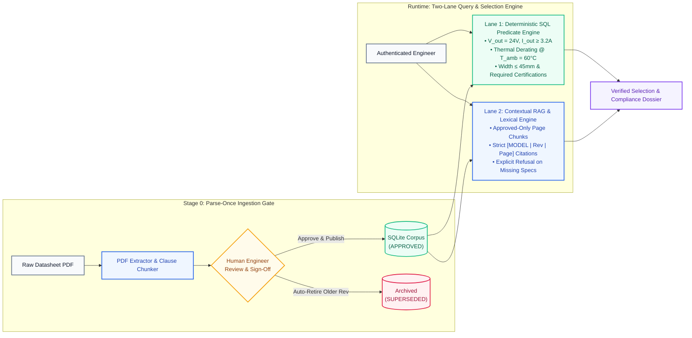
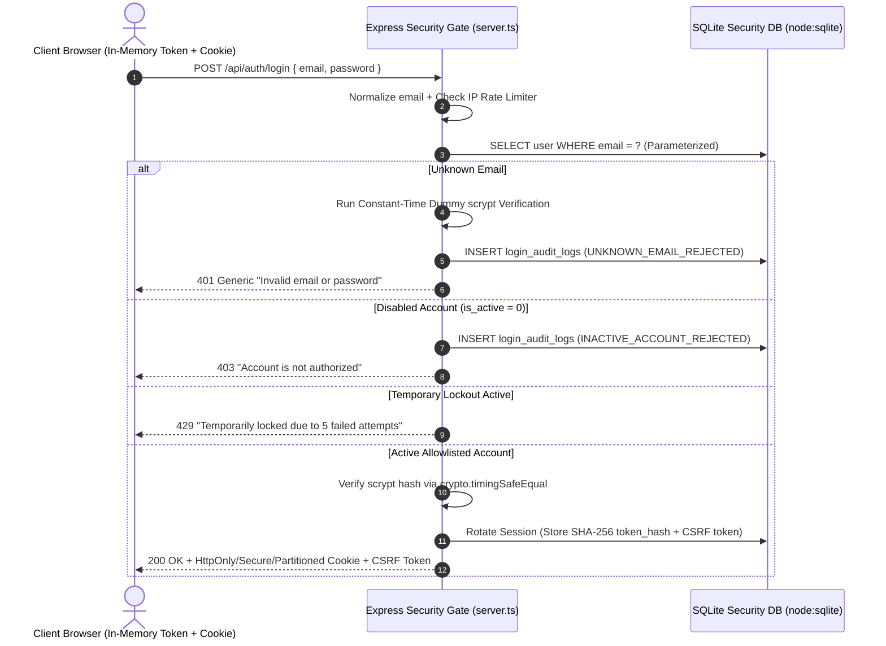

<div align="center">

# SpecTrace
### Deterministic Industrial Product Intelligence & Spec Selection Workbench
***"Parse-Once, Filter-Deterministically, Verify-by-Citation"***

[](#)
[](#two-lane-hybrid-architecture)
[](#strict-private-authentication--database-security)
[](#technology-stack)
[](#technology-stack)
[](#database-schema--row-level-security)

</div>

---

> [!IMPORTANT]
> **Why SpecTrace Exists:** Standard LLM/RAG chatbots fail dangerously in industrial hardware selection because vector similarity cannot reliably evaluate numerical inequalities (`24V DC`, `I_out >= 3.2A`, `T_amb = 60°C` thermal derating) or enforce datasheet revision governance. **SpecTrace** separates hard electrical/thermal constraints from qualitative clause retrieval using a **Two-Lane Hybrid Architecture** inside a strictly private, invitation-only engineering workspace.

---

## Table of Contents

1. [Core Capabilities](#-core-capabilities)
2. [Two-Lane Hybrid Architecture](#-two-lane-hybrid-architecture)
3. [Strict Private Authentication & Database Security](#-strict-private-authentication--database-security)
4. [Pre-Loaded Industrial Corpus (Mean Well DIN-Rail PSUs)](#-pre-loaded-industrial-corpus-mean-well-din-rail-psus)
5. [Database Schema & Row-Level Security](#-database-schema--row-level-security)
6. [12-Scenario Live Security Verification Suite](#-12-scenario-live-security-verification-suite)
7. [Technology Stack](#-technology-stack)
8. [Getting Started & Deployment](#-getting-started--deployment)
9. [API Reference](#-api-reference)

---

## Core Capabilities

| Module | Badge | Functional Description |
| :--- | :--- | :--- |
| **1. Product Finder (`WorkbenchView`)** |  | Evaluates every approved SKU against strict electrical, thermal, certification, and envelope constraints with real-time thermal derating math and exact bound-failure diagnostics. |
| **2. Datasheet Assistant (`DatasheetViewer`)** |  | Slide-over multi-page datasheet inspector and grounded Q&A engine that answers qualitative installation/derating questions with clickable `[MODEL \| Rev \| Page X]` badges and automatic lexical fallback. |
| **3. Datasheet Manager (`IngestView`)** |  | Client-side PDF text extraction (`PDF.js`) + human review gatekeeper. Approving a new revision automatically flips older revisions of the same model to `SUPERSEDED`. |
| **4. Selection Sign-Off (`SignOffView`)** |  | Human engineer suitability sign-off workflow with Row-Level Security (RLS) ownership and one-click exportable Markdown & JSON compliance dossiers. |
| **5. Review Benchmarks (`EvaluationLabView`)** |  | Live benchmark runner comparing **Keyword Search**, **Naive Vector RAG**, **SQL Filter Only**, and **SpecTrace Two-Lane Hybrid** across 6 industrial failure modes. |
| **6. Access & Security (`AdminSecurityView`)** |  | Administrator console for managing the email allowlist, role-based access (`admin` / `user`), single-use 15-minute password reset tokens, session revocation, audit logs, and the 12-scenario live security self-test. |

---

## Two-Lane Hybrid Architecture



> [!TIP]
> **Thermal Derating Precision:** When an engineer specifies an ambient temperature above a power supply's full-load threshold (e.g., `60°C` when derating begins at `50°C` at `2.5%/°C`), SpecTrace computes the exact effective continuous power and current:
> $$\text{Effective LoadFactor} = 1 - \frac{(60 - 50) \times 2.5}{100} = 0.75 \quad (75\% \text{ rated output})$$
> Any SKU whose derated current falls below the required load is deterministically disqualified with a page-cited diagnostic.

---

## Strict Private Authentication & Database Security

SpecTrace operates as a **strictly private, invitation-only application**. Unauthenticated visitors cannot view datasheets, invoke Q&A, or create accounts.



### Security Controls Summary

-  **Zero Public Signup:** `POST /api/auth/register` is permanently blocked (`403 Forbidden`). Only administrators can add users to the allowlist.
- -2563EB?style=flat-square) **Memory-Hard Cryptography:** Passwords are salted with 16 CSPRNG bytes and hashed with `scrypt` (`N=16384, r=8, p=1`, 64-byte key) and compared via `crypto.timingSafeEqual`.
-  **Zero Browser Storage Tokens:** Raw session tokens are never stored in SQLite (only `SHA-256` hashes) and never persisted to `localStorage` or `sessionStorage`.
-  **Lockout & Rate Limiting:** 5 consecutive failed password attempts trigger a temporary 15-minute account cooldown alongside IP-based rate limiting.
-  **Defense-in-Depth Headers:** Enforces Content-Security-Policy (CSP), `X-Content-Type-Options: nosniff`, `Referrer-Policy: no-referrer`, and dual `X-CSRF-Token` + `X-Requested-With` validation on all state-changing requests.

---

## Pre-Loaded Industrial Corpus (Mean Well DIN-Rail PSUs)

| Model Code | Revision | Governance Status | Output Rating | Width | Full-Load Temp | Derating Slope | Key Certifications |
| :--- | :---: | :---: | :---: | :---: | :---: | :---: | :--- |
| **`DR-75-24`** | `Rev 2024-11` |  | `24V DC / 3.2A (76.8W)` | `55.5 mm` | `50°C` | `2.5% / °C` | `UL508, TUV BS EN/EN62368-1, EAC, CE, UKCA` |
| **`DR-75-12`** | `Rev 2024-09` |  | `12V DC / 6.3A (75.6W)` | `55.5 mm` | `50°C` | `2.5% / °C` | `UL508, TUV BS EN/EN62368-1, CE, UKCA` |
| **`DR-75-48`** | `Rev 2024-09` |  | `48V DC / 1.6A (76.8W)` | `55.5 mm` | `50°C` | `2.5% / °C` | `UL508, TUV BS EN/EN62368-1, CE, UKCA` |
| **`SDR-120-24`** | `Rev 2024-10` |  | `24V DC / 5.0A (120W)` | `40.0 mm` | `60°C` | `2.5% / °C` | `UL508, TUV BS EN/EN62368-1, SEMI F47, GL, CE` |
| **`NDR-75-24`** | `Rev 2024-08` |  | `24V DC / 3.2A (76.8W)` | `32.0 mm` | `50°C` | `2.5% / °C` | `UL508, TUV BS EN/EN62368-1, CE, UKCA` |
| **`DR-75-24`** | `Rev 2019-03` |  | `24V DC / 3.2A (76.8W)` | `55.5 mm` | `45°C` | `3.0% / °C` | `UL508, EN60950-1 (Legacy), CE` |

---

## Database Schema & Row-Level Security

All application security and state persistence live in `data/spectrace_security.sqlite`:

| Table Name | Primary Key | Purpose & Security Policy |
| :--- | :--- | :--- |
| **`users`** | `id (TEXT)` | Allowlisted accounts (`email UNIQUE`, `password_hash`, `role`, `is_active`, `failed_login_attempts`, `locked_until`, `last_login`). `password_hash` is stripped at the database query layer. |
| **`sessions`** | `id (TEXT)` | Active server-side sessions storing `token_hash (SHA-256)`, `csrf_token`, `user_id`, `ip_address`, `last_active_at` (30m idle timeout), and `expires_at` (8h max TTL). |
| **`password_reset_tokens`** | `id (TEXT)` | Single-use 15-minute reset tokens stored as `SHA-256` hashes (`token_hash`, `expires_at`, `used_at`). Consuming a token automatically revokes all existing sessions for that user. |
| **`login_audit_logs`** | `id (TEXT)` | Immutable security ledger recording timestamp, normalized email, event type, outcome (`ALLOW` / `DENY` / `INFO`), IP address, and details. |
| **`corpus_revisions`** | `id (TEXT)` | Revision-controlled datasheet records (`APPROVED`, `DRAFT`, `SUPERSEDED`). Only `admin` users can approve or reset corpus revisions. |
| **`signoff_audits`** | `id (TEXT)` | Suitability sign-off records enforced with **Row-Level Security (`owner_user_id`)** so standard users can only read or write their own sign-off records. |

---

## 12-Scenario Live Security Verification Suite

Inside the application (**Access & Security → Run 12-Scenario Verification Suite**), administrators can execute an automated live test suite against the SQLite database:

1.  **Registered Active User Login** — Valid credentials authenticate and create a server session.
2.  **Unregistered Email Login Rejected** — Unknown email fails with a generic message after constant-time dummy verification.
3.  **Registered Email + Wrong Password Rejected** — Invalid password increments failure counter and rejects login.
4.  **Disabled Account (`is_active = false`) Rejected** — Deactivating an account immediately revokes active sessions and blocks login.
5.  **Direct Unauthenticated URL/API Access Blocked** — Unauthenticated requests to `/api/datasheets` return `401 Unauthorized`.
6.  **Public Registration Disabled** — `POST /api/auth/register` returns `403 Forbidden`.
7.  **Expired / Tampered Session Token Rejected** — Forged bearer tokens fail SHA-256 session lookup.
8.  **Logout Destroys Session Immediately** — `POST /api/auth/logout` deletes the session row so replay fails.
9.  **Brute-Force Protection (5 Failed Attempts)** — 5 consecutive failures enforce a temporary 15-minute account cooldown.
10.  **SQL Injection Payload Blocked** — `' OR 1=1 --` and `' UNION SELECT * FROM users --` are safely neutralized by parameterized queries.
11.  **Non-Admin User Blocked from `/api/admin/*`** — Standard `user` role cannot access administrator endpoints (`403 Forbidden`).
12.  **Single-Use Password Reset Token Lifecycle** — Token expires in 15m, updates password, revokes old sessions, and rejects replay.

---

## Technology Stack

- **Frontend:** React 19, TypeScript, Tailwind CSS v4, Lucide Icons, PDF.js (`pdfjs-dist` for real browser PDF text extraction)
- **Backend:** Node.js 22, Express, TypeScript (`tsx`)
- **Database & Cryptography:** Built-in `node:sqlite` (`DatabaseSync` in WAL mode), Node `node:crypto` (`scryptSync`, `timingSafeEqual`, `randomBytes`, `createHash('sha256')`)
- **AI Grounding:** `@google/genai` (`gemini-2.5-flash` server-side grounded Q&A with deterministic lexical fallback)

---

## Getting Started & Deployment

### 1. Environment Configuration

Copy `.env.example` to `.env` and configure your environment variables:

```bash
# Required for live Gemini grounded Q&A (falls back to deterministic lexical engine if omitted)
GEMINI_API_KEY="your_gemini_api_key"

# Optional: Pre-seed the initial administrator account on first boot.
# If omitted, the login screen presents a one-time atomic First-Run Admin Claim form.
INITIAL_ADMIN_EMAIL="admin@company.com"
INITIAL_ADMIN_PASSWORD="YourStrongPassword!2026"
```

> [!WARNING]
> Never commit `.env` or `data/*.sqlite` to version control. Both paths are pre-configured in `.gitignore`.

### 2. Install & Run in Development

```bash
npm install
npm run dev
```
The full-stack Express + Vite server will start on `http://localhost:3000`.

### 3. Production Build & Start

```bash
npm run build
npm start
```

---

## API Reference

| Method | Endpoint | Access Level | Description |
| :---: | :--- | :---: | :--- |
| `GET` | `/api/auth/status` |  | Checks whether the initial administrator account has been claimed. |
| `POST` | `/api/auth/bootstrap` |  | Atomically claims the initial admin account when `users` count is `0`; permanently returns `403` thereafter. |
| `POST` | `/api/auth/register` |  | Always returns `403 Forbidden` (public signup disabled). |
| `POST` | `/api/auth/login` |  | Authenticates allowlisted active users and rotates session & CSRF tokens. |
| `POST` | `/api/auth/logout` |  | Destroys the active server-side session row and clears the `HttpOnly` cookie. |
| `GET` | `/api/datasheets` |  | Returns the revision-controlled datasheet corpus. |
| `GET/POST` | `/api/audits` |  | Lists or records suitability sign-off records scoped by `owner_user_id`. |
| `POST` | `/api/qa` |  | Executes grounded Q&A over `APPROVED` datasheet chunks via server-side Gemini API. |
| `GET/POST` | `/api/admin/users` |  | Lists or adds allowlisted user accounts, toggles `is_active`, changes roles, or issues 15-minute reset tokens. |
| `POST` | `/api/security/run-self-test` |  | Runs the 12-scenario live security verification suite against SQLite. |
